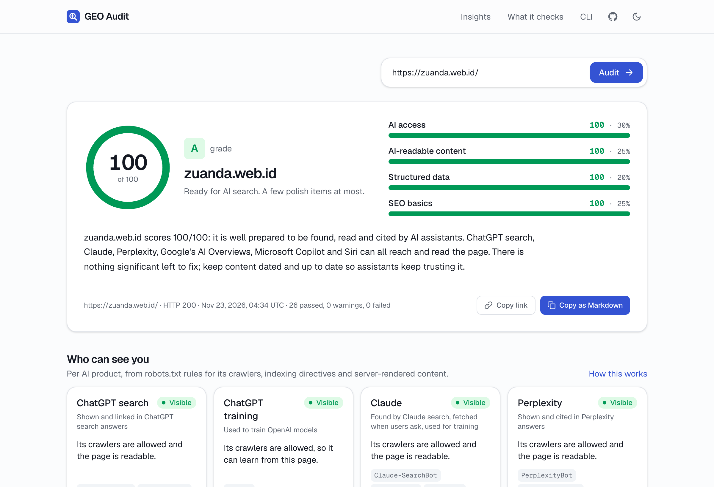

# GEO Audit

**Can ChatGPT, Claude, Perplexity and Google AI Overviews find, read and cite your site?** Enter a URL, get a 0–100 score
and copy-paste fixes. Free, open source, no sign-up.

[](https://github.com/zuandabaransyahputra/geo-audit/actions/workflows/ci.yml)
[](https://www.npmjs.com/package/ai-geo-audit)
[](./LICENSE)

**Web:** https://geoaudit-tool.vercel.app · **CLI:** `npx ai-geo-audit example.com`



## Why

More people ask an assistant than click ten blue links. Assistants answer from pages their crawlers are allowed to fetch,
can read without running JavaScript, and can attribute to someone. GEO (generative engine optimisation) is mostly about
getting those basics right, and most sites get at least one of them wrong: a robots.txt rule that blocks `OAI-SearchBot`,
a React shell with no text in the HTML, no JSON-LD saying who is behind the site.

GEO Audit checks all of it in a few seconds and tells you exactly what to change, with snippets filled in with your
own domain, title and description.

## What it checks

30 checks: 26 in four scored categories, plus 4 in Agent readiness, which is reported but not scored. Each scored check has a
weight inside its category; the last column is its share of the overall score (before any cap).

| Category | Check | ID | Weight | Of total |
| --- | --- | --- | ---: | ---: |
| AI access | AI search and assistant crawlers can reach the page (scored per AI product) | `ai-search-bots` | 5 | 10.7% |
| AI access | Page may be indexed and quoted (meta robots, `X-Robots-Tag`: noindex, nosnippet, noai) | `indexing-directives` | 4 | 8.6% |
| AI access | AI crawlers get the same page as everyone else (firewall and CDN probes) | `firewall-probe` | 3 | 6.4% |
| AI access | robots.txt is present and valid (Content-Signal lines are shown, not scored) | `robots-txt` | 1 | 2.1% |
| AI access | AI training crawlers (blocking is allowed; with the opt-out it does not count) | `ai-training-bots` | 1 | 2.1% |
| AI-readable content | Content is readable without JavaScript (no empty SPA shell) | `server-rendered-text` | 4 | 9.1% |
| AI-readable content | One clear H1 | `single-h1` | 2 | 4.5% |
| AI-readable content | Headings form an outline | `heading-order` | 1 | 2.3% |
| AI-readable content | Images have alt text | `img-alt` | 1 | 2.3% |
| AI-readable content | Language is declared | `lang` | 1 | 2.3% |
| AI-readable content | Freshness signals (`dateModified`, `<time>`, article meta) | `freshness` | 1 | 2.3% |
| AI-readable content | Author or publisher is identified | `authorship` | 1 | 2.3% |
| Structured data | JSON-LD present and parses | `jsonld-present` | 3 | 8.6% |
| Structured data | Useful schema.org types (Organization, Person, WebSite, Article, Product, FAQPage ...) | `jsonld-types` | 2 | 5.7% |
| Structured data | Key fields per type (Google's required properties, simplified) | `jsonld-fields` | 2 | 5.7% |
| Structured data | Microdata and RDFa (noted, not scored) | `microdata-rdfa` | 0 | info |
| SEO basics | Page returns 200 | `http-status` | 3 | 5.0% |
| SEO basics | Served over HTTPS | `https` | 2 | 3.3% |
| SEO basics | Title tag length | `title` | 2 | 3.3% |
| SEO basics | Meta description length | `meta-description` | 2 | 3.3% |
| SEO basics | XML sitemap found and referenced in robots.txt | `sitemap` | 2 | 3.3% |
| SEO basics | Canonical URL | `canonical` | 1 | 1.7% |
| SEO basics | Open Graph tags | `open-graph` | 1 | 1.7% |
| SEO basics | Few redirects | `redirects` | 1 | 1.7% |
| SEO basics | Twitter / X card | `twitter-card` | 0.5 | 0.8% |
| SEO basics | Mobile viewport | `viewport` | 0.5 | 0.8% |
| Agent readiness | llms.txt (Lighthouse's rules: an H1, a Markdown link, 50+ characters) | `llms-txt` | counted | not scored |
| Agent readiness | llms-full.txt is available | `llms-full-txt` | counted | not scored |
| Agent readiness | Buttons, links and form fields have accessible names | `interactive-names` | counted | not scored |
| Agent readiness | Declarative WebMCP tools (`<form toolname tooldescription>`) | `webmcp-declarative` | info | not scored |

**Crawlers checked against robots.txt (23 scored):**

- Search and assistant agents: `Googlebot` (also AI Overviews), `Bingbot` (also Copilot), `Applebot` (Siri, Spotlight),
  `OAI-SearchBot`, `ChatGPT-User`, `Claude-SearchBot`, `Claude-User`, `PerplexityBot`, `Perplexity-User`, `DuckAssistBot`,
  `Amzn-SearchBot`, `MistralAI-Index`, `MistralAI-User`, `meta-webindexer`, `meta-externalfetcher`.
- Training agents: `GPTBot`, `ClaudeBot`, `Google-Extended`, `Applebot-Extended`, `Amazonbot`, `meta-externalagent`,
  `CCBot`, `Bytespider`.
- Listed but never scored: `Google-Agent`. Google says its user-triggered fetchers generally ignore robots.txt.

Every entry in [`packages/core/src/bots.ts`](packages/core/src/bots.ts) has an owner, a purpose, the product it feeds,
the vendor page it was checked against, whether the vendor says it respects robots.txt or may ignore it
(`ChatGPT-User`, `Perplexity-User`, `meta-externalfetcher`, `Google-Agent`), and the date it was verified.

The robots.txt parser follows [RFC 9309](https://www.rfc-editor.org/rfc/rfc9309): user-agent groups (merged when repeated),
the bot's own group over `*`, longest match wins with `Allow` winning ties, `*` wildcards, a trailing `$` anchor,
percent-encoding normalisation, and `/robots.txt` always allowed. A 5xx robots.txt counts as "keep out", a 4xx as
"allow everything", as crawlers treat them. `Content-Signal` lines ([Cloudflare's managed
robots.txt](https://developers.cloudflare.com/bots/additional-configurations/managed-robots-txt/)) are parsed per group
and globally as a non-rule directive and returned as `contentSignals` in the JSON report.

### Agent readiness

Agent readiness covers extras for AI agents and developer tools that act on a page. It is shown as "x of y passed", like
Lighthouse's [Agentic Browsing](https://developer.chrome.com/docs/lighthouse/agentic-browsing/scoring) category, and never
changes the score. A missing llms.txt is information, not a failure (Google Search ignores the file), and the fix is
still offered with a starting point built from your navigation and sitemap. Items from this category get their own
"Optional: agent readiness" group in the action plan and never count as quick wins.

### Firewall and CDN probes

robots.txt can allow a crawler that a firewall then blocks. After the normal request, GEO Audit fetches the page again as
up to four crawlers that robots.txt allows: `OAI-SearchBot`, `PerplexityBot` and `GPTBot` (GPTBot only without a
training opt-out). `Claude-SearchBot` is on the list but skipped, because Anthropic documents no full user agent string.
Each probe sends the vendor's documented user agent with a marker added, for example:

```
Mozilla/5.0 (compatible; PerplexityBot/1.0; +https://perplexity.ai/perplexitybot) GEO-Audit-probe/0.2 (+https://geoaudit-tool.vercel.app)
```

Probes use the same safe fetcher with a 5 s timeout and a 512 KB limit, run in parallel and are never retried. The
verdict per probe is `ok`; `blocked` (401, 403, 429 or 5xx while the normal request got 2xx); `challenge` (a
`cf-mitigated: challenge` header or a known challenge page); `different` (another error status, or under 30% of the
normal page's words); or `error`. The `firewall-probe` check passes when every probe is `ok`. The result is indicative:
real crawlers are also verified by IP address, which a test request cannot imitate. A blocked or challenged probe makes
the product "partly" visible, never "blocked", and never triggers the score cap.

### Training opt-out

Blocking training crawlers is a legitimate choice. Tell the audit it is deliberate and it stops counting against you:
`?training=optout` on `/report` or `/api/audit`, or `--training-optout` in the CLI. It also turns on by itself when
robots.txt has `Content-Signal: ai-train=no` for all crawlers. With the opt-out, `ai-training-bots` is information
(score 1) and training products show "Opted out". Without it, blocked training crawlers sit in the "This week" part of
the plan, labelled "Only if you want models to learn from the site", never in quick wins. The option is part of the
cache key, the share link and the share image.

## Report insights

Every report (web, Markdown export and CLI) adds rule-based insights on top of the checks. There is no AI model
involved: each sentence comes from a template fed by the same results the checks produce, so the insights cannot
contradict them. The code is in [`packages/core/src/insights.ts`](packages/core/src/insights.ts) and
[`packages/core/src/products.ts`](packages/core/src/products.ts).

- **Summary:** two to five sentences on what the score means. It covers any score cap, which assistants can or cannot
  reach the page, the single biggest gap, and the projected score after the quick wins.
- **Who can see you:** a status per AI product (see the mapping below).
- **Action plan:** failing and warning checks, ordered by points gained per unit of effort. They are grouped into
  *Quick wins* (minutes), *This week* (hours), *Bigger projects* (days) and *Optional: agent readiness*. The projected
  scores after the quick wins and after the full plan re-evaluate the cap. Effort labels are static, conservative
  estimates per check (`EFFORT` in `insights.ts`). The projection assumes each fix is complete, so treat it as an upper
  bound.
- **Strengths:** what the site already does well. Passes with nothing to check (no images, two headings) and passes
  with notes are left out.
- **Pass with notes:** a passing check can carry caveats (`notes`), such as `Content-Signal: ai-input=no` or a small
  `max-snippet`.
- **Learn more:** each check links to the [insights article](#insights-articles) that explains it.

### Who can see you: crawler to product mapping

One function, `productStatuses()` in `products.ts`, decides every product's status. The `ai-search-bots` score, this
panel and the score cap all read from it, so they cannot disagree.

A product is **blocked** when robots.txt blocks its primary crawler (one that respects robots.txt). It is **partly**
visible when a secondary crawler or a may-ignore crawler is blocked, or when one of these applies:

- the page is marked `noindex` (blocked for Google and Bing, which document it; partly for the others);
- `nosnippet` / `max-snippet:0` is set (partly for Google and Apple, whose answers honour it);
- the content only appears after JavaScript runs (partly for everyone except Google, whose crawler renders JS);
- the page returns an error status;
- a firewall probe for one of its crawlers was blocked or challenged.

A 404/410 page, or a robots.txt that answers 5xx, counts as blocked everywhere. Training-only crawlers inside an answer
product (ClaudeBot, Google-Extended, Applebot-Extended, Amazonbot, meta-externalagent) never make it less findable.

**Major products**

| Product | Primary crawler (blocked = Blocked) | Secondary crawlers (blocked = Partly) | Source |
| --- | --- | --- | --- |
| ChatGPT search | `OAI-SearchBot` | `ChatGPT-User` (OpenAI: robots.txt rules may not apply) | [OpenAI crawlers](https://developers.openai.com/api/docs/bots) |
| Claude | `Claude-SearchBot` | `Claude-User`, `ClaudeBot` (training) | [Anthropic crawlers](https://support.claude.com/en/articles/8896518-does-anthropic-crawl-data-from-the-web-and-how-can-site-owners-block-the-crawler) |
| Perplexity | `PerplexityBot` | `Perplexity-User` (Perplexity: generally ignores robots.txt) | [Perplexity crawlers](https://docs.perplexity.ai/guides/bots) |
| Google AI Overviews & Gemini | `Googlebot` (AI Overviews need indexed, snippet-eligible pages) | `Google-Extended` (Gemini training and grounding; does not affect Search) | [AI features](https://developers.google.com/search/docs/appearance/ai-features), [Google crawlers](https://developers.google.com/crawling/docs/crawlers-fetchers/google-common-crawlers) |
| Microsoft Copilot & Bing | `Bingbot` | none | [Bing crawlers](https://www.bing.com/webmasters/help/which-crawlers-does-bing-use-8c184ec0) |
| Apple Intelligence & Siri | `Applebot` (Siri, Spotlight, Safari) | `Applebot-Extended` (model training only; pages stay in search) | [About Applebot](https://support.apple.com/en-us/119829) |

**Other products**

| Product | Primary crawler | Secondary crawlers | Source |
| --- | --- | --- | --- |
| DuckDuckGo AI-assisted answers | `DuckAssistBot` | none | [DuckAssistBot](https://duckduckgo.com/duckduckgo-help-pages/results/duckassistbot) |
| Amazon Alexa & search | `Amzn-SearchBot` | `Amazonbot` (may be used for model training) | [Amazonbot](https://developer.amazon.com/amazonbot) |
| Mistral Vibe | `MistralAI-Index` | `MistralAI-User` | [Mistral crawlers](https://docs.mistral.ai/robots) |
| Meta AI | `meta-webindexer` | `meta-externalfetcher` (may bypass robots.txt), `meta-externalagent` (training) | [Meta crawlers](https://developers.facebook.com/docs/sharing/webmasters/web-crawlers/) |
| ChatGPT training | `GPTBot` | none | [OpenAI crawlers](https://developers.openai.com/api/docs/bots) |
| Common Crawl & other model builders | none | `CCBot`, `Bytespider` (all blocked = Blocked) | [CCBot](https://commoncrawl.org/ccbot) |

Robots rules are what vendors document. Whether a given product actually fetched or cited a page is something only
your server logs and analytics can tell (see
[How to measure traffic from AI assistants](https://geoaudit-tool.vercel.app/insights/measuring-ai-traffic)).

## Insights articles

The site also hosts short, practical guides at [`/insights`](https://geoaudit-tool.vercel.app/insights). They are
Markdown files in [`apps/web/content/insights`](apps/web/content/insights), with metadata in
[`apps/web/lib/insights.ts`](apps/web/lib/insights.ts). The articles are listed in the sitemap and in the site's own
`/llms.txt`, and `/llms-full.txt` contains their full text.

## How scoring works

- Every check earns 0–100% of its weight: pass = 100%, fail = 0%, warnings in between (often proportional, e.g. the
  share of crawlers allowed or images with alt text).
- **`ai-search-bots` is scored per AI product**, not per crawler, so small crawlers cannot dilute a blocked major one.
  Major products weigh 1, other products 0.5. A blocked primary crawler costs the whole product; a blocked secondary
  or may-ignore crawler costs half. A blocked Googlebot or Bingbot is always a failure.
- **Category score** = earned weight ÷ total weight × 100.
- **Raw score** = weighted average of the scored categories:

  | Category | Weight |
  | --- | ---: |
  | AI access | 30% |
  | AI-readable content | 25% |
  | Structured data | 20% |
  | SEO basics | 25% |
  | Agent readiness | not scored |

- **Cap.** A page that the major assistants cannot reach should not grade well, however clean its HTML. The score is
  capped by the number of major products (ChatGPT search, Claude, Perplexity, Google, Copilot & Bing, Apple) that are
  blocked:

  | Major products blocked | Highest score |
  | ---: | ---: |
  | 1 | 89 |
  | 2 | 79 |
  | 3–4 | 69 |
  | 5–6 | 54 |

  A failing `server-rendered-text` check (an app shell) caps the score at 69. The lowest cap that applies wins. The
  report shows `rawScore`, `score` (after the cap) and `cap: { limit, reasons }` (null when no cap lowered the score),
  for example "Capped at 69: ChatGPT search, Claude and Perplexity are blocked by robots.txt. Without the cap: 93."
- **Grade** (from the capped score): A ≥ 90, B ≥ 80, C ≥ 70, D ≥ 55, F below.
- **Points per fix** = how many overall points the check would add if it passed, or more when the fix also lifts the
  cap. The action plan orders fixes by points per unit of effort.

The weights are a judgement call: being reachable and quotable matters most, and the classic SEO basics still count
because AI search is built on top of search indexes. They live in
[`packages/core/src/score.ts`](packages/core/src/score.ts) and the check modules in
[`packages/core/src/checks/`](packages/core/src/checks). Design decisions are recorded in [`docs/adr`](docs/adr).
PRs with evidence are welcome.

## Use it

### Web

Open https://geoaudit-tool.vercel.app, enter a URL, share the report link (`/report?url=example.com`, plus
`&training=optout` if you block training crawlers on purpose). Each report has a "Copy as Markdown" button for issues
and PRs, and its own share image showing the domain and score.

JSON: `GET /api/audit?url=example.com` (optional `&training=optout`). The report includes `score`, `rawScore`, `cap`,
`categories` (Agent readiness with a `tally`), `insights`, `probes`, `contentSignals` and `options`.

### CLI

```sh
npx ai-geo-audit example.com
npx ai-geo-audit https://example.com/blog/post --markdown > geo-report.md
npx ai-geo-audit example.com --json | jq .score
npx ai-geo-audit example.com --min-score 80   # exit 1 below 80 (after any cap): use it as a CI gate after deploys
npx ai-geo-audit example.com --training-optout
```

Options: `--json`, `--markdown`/`--md`, `--all` (details for passing checks too), `--min-score <n>`,
`--training-optout`, `--no-color`.

## Self-host

Requirements: Node 22+, pnpm 10.

```sh
git clone https://github.com/zuandabaransyahputra/geo-audit
cd geo-audit
pnpm install
pnpm dev          # web app on http://localhost:3000
pnpm test         # core tests (Vitest)
pnpm build        # builds the CLI and the web app
node packages/cli/dist/index.js example.com
```

**Vercel:** import the repo and set the project's Root Directory to `apps/web` (framework: Next.js, Node runtime). One
optional environment variable: `OG_SECRET` (any long random string) signs the scores in share-image URLs, so
link previews on Slack, WhatsApp or LinkedIn show the score card instantly without re-running the audit; without it
they show a generic card. If you deploy under a different domain, change `SITE_URL` in
[`packages/core/src/constants.ts`](packages/core/src/constants.ts); it is used for metadata, share links and the
crawler's User-Agent.

### Layout

```
packages/core   checks (one module per category), bot list and products, robots.txt parser, llms.txt validator,
                JSON-LD extraction, scoring and cap, firewall probes, safe fetching (pure TS, tested)
packages/cli    the `ai-geo-audit` command (bundles core)
apps/web        Next.js App Router site: home, /report, /insights, /api/audit, /api/og
```

## Safety

The server fetches URLs that users type in, so it is careful about where it goes:

- Only `http`/`https`, only ports 80 and 443, no credentials in URLs, no `localhost`/`.local`/`.internal` names.
- DNS answers are checked at connect time: private, loopback, link-local, CGNAT, multicast, reserved, cloud metadata
  (`169.254.169.254`, `fd00:ec2::254`), IPv6 ULA and IPv4-embedding IPv6 ranges are refused. Node connects to the exact
  address that was checked, so DNS rebinding does not help. Every redirect (max 5) is re-checked.
- 8 s timeout and 2 MB limit per request (counted after decompression), content-type allow-lists, no cookies.
- Pages are parsed with a light HTML parser; fetched JavaScript is never executed.
- Per-IP rate limit (in memory, best effort) and a 10-minute result cache.
- Requests identify honestly as `GEO-Audit/0.2.0 (+https://geoaudit-tool.vercel.app)`. The up to 4 firewall probes use
  the AI crawler's documented user agent with `GEO-Audit-probe/0.2 (+https://geoaudit-tool.vercel.app)` added, so they are
  easy to find in logs. Probes go through the same safe fetcher and SSRF checks, with a 5 s timeout and 512 KB limit.

## Privacy

The hosted version fetches only the page you enter plus `/robots.txt`, `/llms.txt`, `/llms-full.txt` and the sitemap
of that origin, and the same page again up to 4 times as AI crawlers (the firewall probes). Results are kept in server memory for 10 minutes so shared links load instantly, then dropped. URLs
are not stored in a database, there are no accounts and no analytics. Report pages are `noindex`.

## Related

- [astro-geo](https://github.com/zuandabaransyahputra/astro-geo): an Astro integration that generates `llms.txt`,
  `llms-full.txt` and typed, injection-safe JSON-LD. If your Astro site misses those checks, it fixes them at build time.
- [llmstxt.org](https://llmstxt.org), [RFC 9309](https://www.rfc-editor.org/rfc/rfc9309),
  [schema.org](https://schema.org), [Google's structured data docs](https://developers.google.com/search/docs/appearance/structured-data/intro-structured-data).

## Credits

Built by [Zuanda Baransyah Putra](https://zuanda.web.id), freelance web developer (Next.js, Astro, React). Need help
fixing what the report found? [Hire me](https://zuanda.web.id/contact).

MIT licensed. See [LICENSE](./LICENSE).
